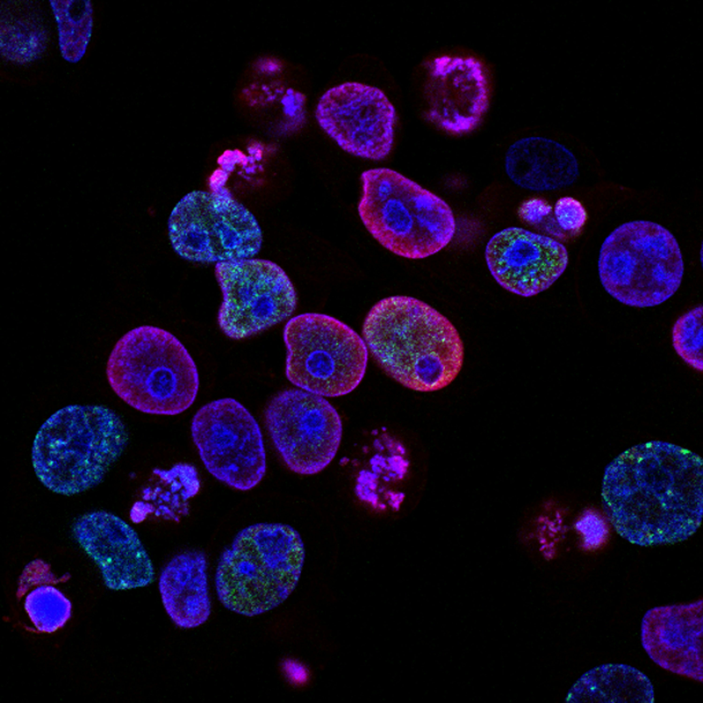

# Dhruv Aditya Srivastava, Ph.D.

**Plant Scientist · Data Scientist · Ag R&D**

[Website](https://dhruvadityasrivastava.com/) | [Download CV](https://assets.zyrosite.com/mjEGMKX70givnpvx/dhruv-aditya-srivastava_cv-GfWUMWbb4IpTdUHq.pdf) | [LinkedIn](https://www.linkedin.com/in/dhruv-aditya-srivastava/) | [Google Scholar](https://shorturl.at/hYrV9) | [GitHub](https://github.com/dhruvadityasrivastava) | dhruvaditya88@gmail.com

I turn plant and microbe biology into practical, data-driven answers for agriculture: greenhouse and field trials, machine learning, and clear insight for growers and product teams.

## Professional Summary
Plant scientist with 12+ years of research in India, Israel and the USA, working on biologicals, crop nutrition and plant disease, and pairing crop trials with data science. Currently a postdoctoral researcher at Penn State studying how plant nutrition shapes the support maize gets from arbuscular mycorrhizal fungi. I design randomised greenhouse and field trials and analyse them in R and Python (RNA-seq, WGCNA co-expression networks, ionomics, microbiome sequencing, machine learning). Open to industry and academic roles.

**At a glance:** 12+ years in research · 11 papers and book chapters, plus a 2026 preprint · 380+ citations · h-index 8 · 30+ talks and posters · 4 students mentored · 5 crops (maize, soybean, alfalfa, tomato, sorghum) · 3 countries

## What I work on

### Biologicals & Nutrition
I study how soil microbes and inoculants trade nutrients with crops and help them cope with stress. At Penn State I look at how plant nutrition shapes the support maize gets from arbuscular mycorrhizal fungi. At Missouri I ran ¹³C-labelling studies of carbon and nutrient exchange in mycorrhizal networks and led three RNA-seq projects on drought stress. Before that, in Israel, I worked on the grey-mould fungus *Botrytis cinerea* and on the biocontrol yeast *Pseudozyma aphidis*.

### Data Science & Ag R&D
I turn plant data into decisions: randomised greenhouse and field trials, analysed in R and Python with RNA-seq and WGCNA co-expression networks, ionomics, microbiome sequencing with QIIME, and machine learning. I completed the UT Austin postgraduate program in AI and machine learning and build my own tools, from SVM feature-selection pipelines to a neural network that identifies plant seedlings from photos. See [Projects](./projects.md).

## What I bring to a team
*   **Trial design that answers the business question** - randomised greenhouse and field trials with the right controls and replication.
*   **Data to decision** - reproducible pipelines in R and Python, clear models and visuals, plus AI/ML training from UT Austin.
*   **Biologicals know-how** - mycorrhizal fungi, rhizobia, biocontrol yeasts and pathogens: the science behind inoculants and bio-based crop protection.
*   **Project leadership** - led three RNA-seq projects end to end, won a postdoctoral research grant and mentored four students.
*   **Clear communication** - 30+ talks and posters, plus hands-on demos for farmers and students.
*   **Adaptable across teams** - worked in India, Israel and the USA, across molecular biology, pathology, physiology and data science.

*Where I can add value:* agricultural biologicals & inoculants · crop protection · ag-tech & precision agriculture · seed & breeding · greenhouse & controlled-environment farming · bioinformatics & data science

## Experience
*   **2025 – now · Penn State University** - Postdoc on maize and arbuscular mycorrhizal fungi: how nutrition shapes the partnership, using RNA-seq and network analysis.
*   **2022 – 2025 · University of Missouri** - Postdoc. Led three RNA-seq projects on drought stress, built WGCNA co-expression networks and ran ¹³C-labelling studies of nutrient exchange. Won a research grant and mentored four students.
*   **2019 – 2022 · Hebrew University of Jerusalem** - Postdoc on fungus–plant–biocontrol transcriptomics; gene knockout, RNAi and overexpression in fungi and plants.
*   **2018 – 2019 · Volcani Center (ARO), Israel** - Postdoc on how fungal and oomycete pathogens infect crops, plus microbiome analysis with QIIME.
*   **2012 – 2018 · Hebrew University of Jerusalem** - PhD in Plant Sciences on how barley acclimates to heat and drought.

More detail: [Research Experience](./research.md)

## Education
*   **Ph.D. in Plant Science in Agriculture** - The Hebrew University of Jerusalem, Israel (2012–2018)
*   **Post Graduate Program in Artificial Intelligence and Machine Learning** - The University of Texas at Austin, with Great Learning (2023–2024)
*   **Master of Technology in Biotechnology** - Indian Institute of Technology (IIT) Guwahati, India (2010–2012)
*   **Bachelor of Technology in Biotechnology** - National Institute of Technology (NIT) Durgapur, India (2006–2010)

## Awards & Grants
*   Awarded a postdoctoral research grant (USD 1,500) for a project on nutrient resource allocation in mycorrhizal networks (December 2022).

## Conference Presentations
*   11 talks and 20 posters at international conferences in Israel, the USA and Europe.

## Latest
*   **Preprint (Feb 2026).** With Nishtha Srivastava and Johannes Faber: a physics-informed deep-learning model that tells earthquakes, quarry blasts and noise apart, with 97.56% accuracy. [Read on arXiv](https://arxiv.org/abs/2602.15993)
*   **Talk at the CRRB conference (May 2026).** "Root nutrition acquired by Arbuscular Mycorrhiza (AM) Fungi", presented at Penn State's Center for Root and Rhizosphere Biology, from my work in Dr. Ruairidh Sawers' lab.
*   **Two open-source AI tools (Sep 2026).** [Hallucination Check](https://github.com/dhruvadityasrivastava/hallucination-check) scores whether an AI answer holds up. [analysis-brief](https://github.com/dhruvadityasrivastava/analysis-brief), built with Nishtha Srivastava, turns big tables and logs into a one-page brief.
*   **Bioinformatics certificate (Sep 2026).** Genomic Data Science and Clustering (Bioinformatics V), University of California San Diego. [View credential](https://www.coursera.org/account/accomplishments/records/40YBOCK0QA4W)
*   **New poetry book.** निष्ठा (Nishtha), my second Hindi collection, written as Nripasha. [See the book](https://kavinripasha.dhruvadityasrivastava.com/)

## Get in touch
Open to R&D, biologicals, crop science, data science and ag-tech roles, and to research collaborations. Email: dhruvaditya88@gmail.com

---

[Research Experience](./research.md) | [Publications](./publications.md) | [Projects](./projects.md) | [Skills](./skills.md) | [Hobbies and Interests](./hobbies.md) | [Personal Blog](./personal-blog.md) | [Full website](https://dhruvadityasrivastava.com/)
