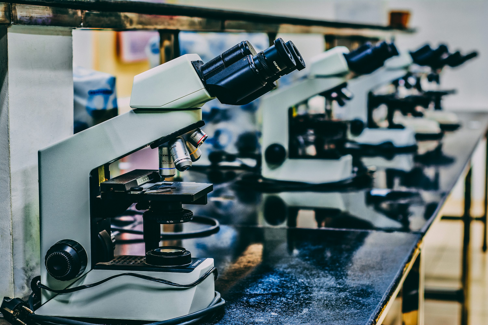

# Research Experience

## Research areas
*   **Mycorrhizal Symbiosis** - How plant nutrition shapes the role of arbuscular mycorrhizal (AM) fungi in abiotic stress tolerance.
*   **Fungal Pathogenesis** - Genes *Botrytis cinerea* needs to infect crops (Nature Communications, 2019).
*   **AI & Machine Learning** - ML pipelines and AI tools for plant data, and deep learning in seismology.
*   **Biocontrol & Microbiome** - How beneficial microbes like *Pseudozyma aphidis* protect plants.

## Positions

### Post-Doctoral Researcher | Penn State University, PA (October 2025–Present)
*   Studying how plant nutrition shapes the way arbuscular mycorrhizal fungi help maize cope with abiotic stress.
*   Combining greenhouse and field trials with ionomics, ¹³C labelling, RNA-seq and network analysis.
*   Presented "Root nutrition acquired by Arbuscular Mycorrhiza (AM) Fungi" at Penn State's Center for Root and Rhizosphere Biology (CRRB) conference, May 2026.

### Post-Doctoral Researcher | University of Missouri, Columbia, MO (July 2022–2025)
*   Led three RNA-seq projects on drought stress end to end, including complex drought-stress RNA sequencing data analysis.
*   Analysed RNA-seq data using R and Shell scripting and built WGCNA co-expression networks.
*   Conducted nutrient and carbon allocation studies using ¹³C labelling experiments and analysed complex field data.
*   Mentored four students: two graduate students, one post-graduate student and one undergraduate student.
*   Awarded a postdoctoral grant of USD 1,500 for a project on nutrient resource allocation in mycorrhizal networks.

### Post-Doctoral Researcher | The Hebrew University of Jerusalem, Israel (October 2019–June 2022)
*   Led transcriptomic studies of fungal–plant–biocontrol interactions.
*   Developed constructs for gene knockout, RNAi silencing and overexpression in fungi and plants.
*   Conducted protein expression and purification from *E. coli* and performed protein biochemical assays.
*   Extensively used molecular biology techniques including cloning (Golden Gate, Gateway), quantitative PCR and Agrobacterium-mediated transformation.

### Post-Doctoral Researcher | Volcani Center, ARO, Israel (January 2018–October 2019)
*   Deciphered pathogenicity mechanisms of phytopathogenic fungi and oomycetes using molecular and bioinformatic approaches.
*   Conducted microbiome sampling and bioinformatic analysis using QIIME.
*   Performed in vitro RNA synthesis and 18S RNA analysis.

## Theses
*   **PhD, The Hebrew University of Jerusalem (2012–2018):** Barley acclimation to heat and drought stress using proteomics and protein biochemistry.
*   **M.Tech. in Biotechnology, IIT Guwahati (2010–2012, CGPA 8.95/10):** Calcium signalling genes in the circadian rhythms of *Neurospora crassa*.

[back](./)
